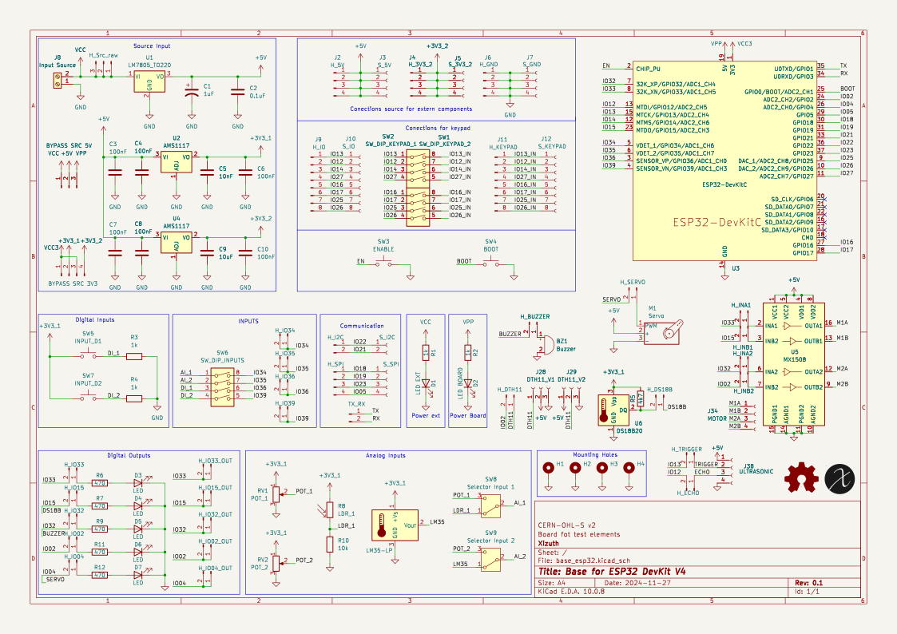
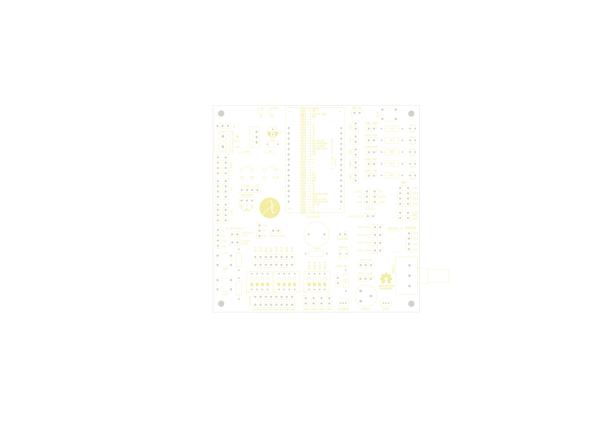
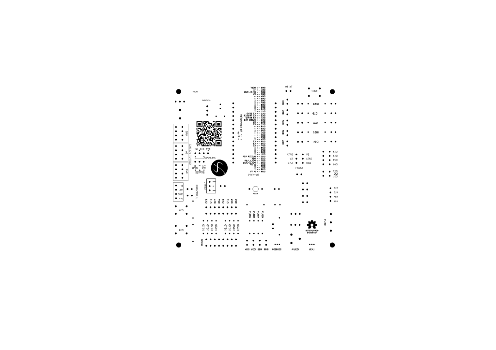
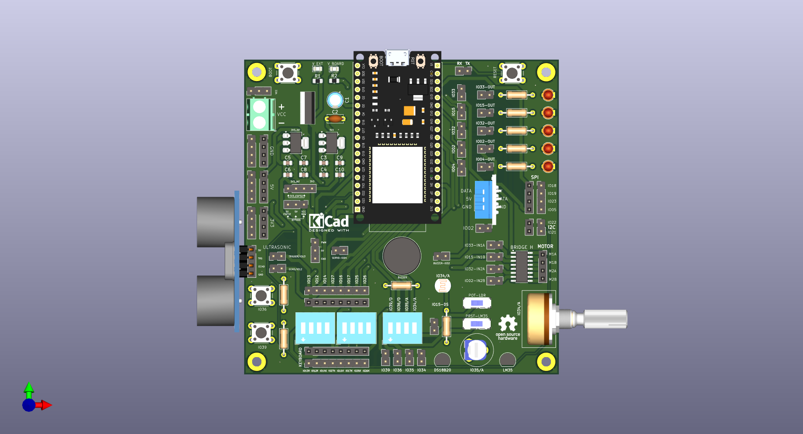
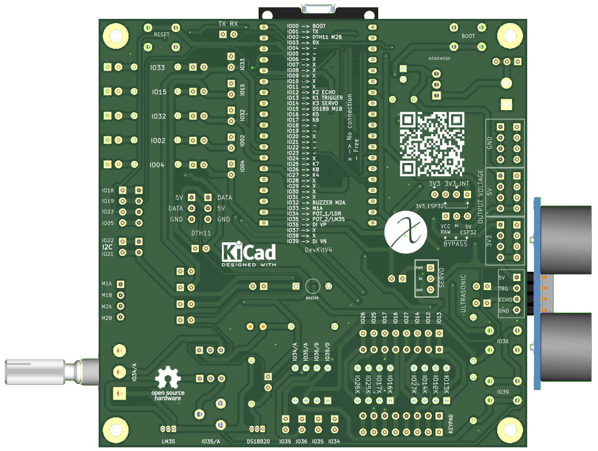
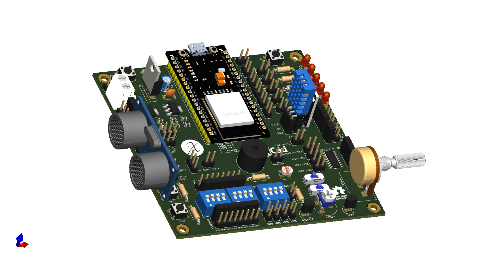
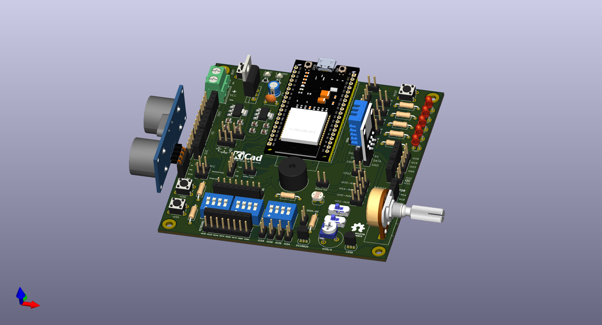
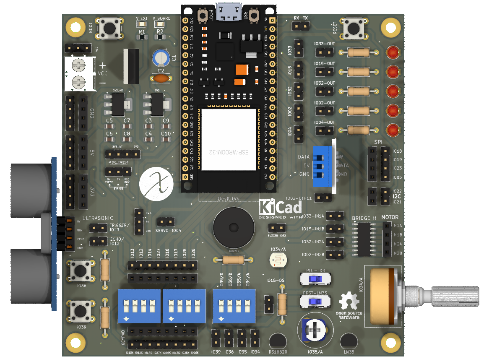
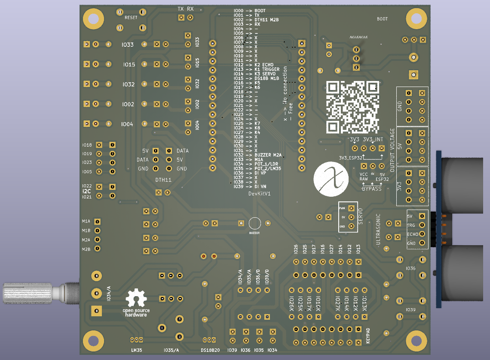

# XB-Uno

*Xizuth Board*
> ***Before:** Base for ESP32 for DevKit V4*

Plataforma modular de desarrollo de hardware embebido y IoT basada en el microcontrolador ESP32 (DevKit V4) que concentra periféricos de entrada, salida, potencia y comunicación bajo una topología de interconexión no estática. A diferencia de las tarjetas entrenadoras convencionales con conexiones rígidas, este diseño incorpora bancos de DIP switches y arreglos de jumpers de aislamiento en todas sus secciones: fuentes de alimentación con bypass, entradas digitales y analógicas seleccionables, indicadores LED, puente H para motores DC, zumbador, zócalos para sensores removibles y puertos de expansión para teclado matricial, I2C, SPI y UART. De esta forma, es posible desconectar cualquier elemento integrado para liberar los pines GPIO del ESP32, interactuar con hardware externo o instrumentar las líneas con osciloscopio y analizador lógico durante la depuración de firmware.

* **Gestión de energía:** Bornera de entrada (`J8`) conectada a un regulador de 5 V (`LM7805`) con puente de *bypass*, acompañada de dos reguladores de 3.3 V (`AMS1117`: uno exclusivo para la placa/ESP32 y otro para periféricos externos) y rieles de distribución de 5 V, 3.3 V y GND.
* **Entradas digitales:** Dos pulsadores físicos (`INPUT_D1`, `INPUT_D2`) y un *DIP switch* de 4 posiciones (`SW6`) con cabezales de acceso para los pines de entrada del ESP32 (GPIO 34, 35, 36 y 39).
* **Entradas analógicas seleccionables:** Dos canales analógicos (`AI_1`, `AI_2`) configurables mediante interruptores selectores (`SW8`, `SW9`) para alternar entre dos potenciómetros (`RV1`, `RV2`), una fotorresistencia (`LDR`) y un sensor de temperatura analógico (`LM35`).
* **Salidas digitales y actuadores:** Cinco indicadores LED con *jumpers* de aislamiento individual (GPIO 33, 15, 32, 2 y 4), un zumbador piezoeléctrico (`BZ1`), cabezal para servomotor y un controlador puente H dual (`MX1508`) para motores DC.
* **Sensores removibles:** Zócalos intercambiables con *jumpers* de desconexión para sensor ultrasónico (`HC-SR04`), sensor de temperatura y humedad (`DHT11`) y sensor digital de temperatura 1-Wire (`DS18B20`).
* **Comunicación y expansión:** Puertos dedicados (macho y hembra) para buses **I2C**, **SPI** y **UART (TX/RX)**, además de un puerto de expansión de 8 líneas aislado por dos *DIP switches* (`SW1`, `SW2`) orientado a teclados matriciales o E/S de propósito general.

## Schematic

This board is a base to connect different components to test. Make easy life



### 1. Mapeo Maestro de Pines (XB-Uno)

| Pin ESP32  | Función / ADC / DAC  | Periférico(s) Conectado(s) en XB-Uno                | Observaciones de Compartición                                                      |
|:-----------|:---------------------|:----------------------------------------------------|:-----------------------------------------------------------------------------------|
| **EN**     | `CHIP_PU`            | Pulsador `RESET` (`SW3` / `ENABLE`)                 | Reinicio físico del microcontrolador.                                              |
| **GPIO0**  | `BOOT` / `ADC2_CH1`  | Pulsador `BOOT` (`SW4`)                             | Modo de programación (*flashing*).                                                 |
| **GPIO1**  | `U0TXD`              | Puerto UART (`TX`)                                  | Comunicación serial / depuración.                                                  |
| **GPIO2**  | `ADC2_CH2`           | LED `D6` / Sensor `DHT11` / Puente H `IN2B`         | Compartido entre 3 etapas; aislar las no usadas con jumper.                        |
| **GPIO3**  | `U0RXD`              | Puerto UART (`RX`)                                  | Comunicación serial / depuración.                                                  |
| **GPIO4**  | `ADC2_CH0`           | LED `D7` / Servomotor (`M1`)                        | Compartido entre indicador LED y señal PWM de servo.                               |
| **GPIO5**  | `VSPI_CS0`           | Bus SPI (`CS` / Pin 4)                              | Cabezal macho (`H_SPI`) y hembra (`S_SPI`).                                        |
| **GPIO12** | `MTDI` / `ADC2_CH5`  | Ultrasónico (`ECHO`) / Expansión Pin 2 (`IO12K`)    | Compartido entre sensor ultrasónico y puerto de teclado.                           |
| **GPIO13** | `MTCK` / `ADC2_CH4`  | Ultrasónico (`TRIGGER`) / Expansión Pin 1 (`IO13K`) | Compartido entre sensor ultrasónico y puerto de teclado.                           |
| **GPIO14** | `MTMS` / `ADC2_CH6`  | Expansión-Teclado Pin 3 (`IO14K`)                   | Configurable mediante `SW2` (Pos. 3).                                              |
| **GPIO15** | `MTDO` / `ADC2_CH3`  | LED `D4` / Sensor `DS18B20` / Puente H `IN1B`       | Compartido entre 3 etapas; aislar las no usadas con jumper.                        |
| **GPIO16** | `U2RXD`              | Expansión-Teclado Pin 5 (`IO16K`)                   | Configurable mediante `SW1` (Pos. 1).                                              |
| **GPIO17** | `U2TXD`              | Expansión-Teclado Pin 6 (`IO17K`)                   | Configurable mediante `SW1` (Pos. 2).                                              |
| **GPIO18** | `VSPI_CLK`           | Bus SPI (`SCK` / Pin 1)                             | Cabezal macho (`H_SPI`) y hembra (`S_SPI`).                                        |
| **GPIO19** | `VSPI_MISO`          | Bus SPI (`MISO` / Pin 2)                            | Cabezal macho (`H_SPI`) y hembra (`S_SPI`).                                        |
| **GPIO21** | `I2C_SDA`            | Bus I2C (`SDA` / Pin 2)                             | Cabezal macho (`H_I2C`) y hembra (`S_I2C`).                                        |
| **GPIO22** | `I2C_SCL`            | Bus I2C (`SCL` / Pin 1)                             | Cabezal macho (`H_I2C`) y hembra (`S_I2C`).                                        |
| **GPIO23** | `VSPI_MOSI`          | Bus SPI (`MOSI` / Pin 3)                            | Cabezal macho (`H_SPI`) y hembra (`S_SPI`).                                        |
| **GPIO25** | `DAC_1` / `ADC2_CH8` | Expansión-Teclado Pin 7 (`IO25K`)                   | Configurable mediante `SW1` (Pos. 3).                                              |
| **GPIO26** | `DAC_2` / `ADC2_CH9` | Expansión-Teclado Pin 8 (`IO26K`)                   | Configurable mediante `SW1` (Pos. 4).                                              |
| **GPIO27** | `ADC2_CH7`           | Expansión-Teclado Pin 4 (`IO27K`)                   | Configurable mediante `SW2` (Pos. 4).                                              |
| **GPIO32** | `ADC1_CH4`           | LED `D5` / Zumbador (`BZ1`) / Puente H `IN2A`       | Compartido entre 3 etapas; aislar las no usadas con jumper.                        |
| **GPIO33** | `ADC1_CH5`           | LED `D3` / Puente H `IN1A`                          | Compartido entre indicador LED y control de motor.                                 |
| **GPIO34** | `ADC1_CH6`           | Entrada Analógica 1 (`AI_1`: `POT_1` o `LDR`)       | Pin solo de entrada; sin *pull-up/down* interno.                                   |
| **GPIO35** | `ADC1_CH7`           | Entrada Analógica 2 (`AI_2`: `POT_2` o `LM35`)      | Pin solo de entrada; sin *pull-up/down* interno.                                   |
| **GPIO36** | `ADC1_CH0`           | Entrada Digital 1 (`DI_1`: Pulsador `SW5`)          | Pin solo de entrada; resistencia *pull-down* externa de $1\text{ k}\Omega$ (`R3`). |
| **GPIO39** | `ADC1_CH3`           | Entrada Digital 2 (`DI_2`: Pulsador `SW7`)          | Pin solo de entrada; resistencia *pull-down* externa de $1\text{ k}\Omega$ (`R4`). |

### 2. Jumpers de Aislamiento de Periféricos

Colocar el jumper habilita el periférico integrado en la placa; retirarlo libera el GPIO para uso externo o permite conectar puntas de medición (osciloscopio / analizador lógico) directamente sobre el cabezal.

| Etiqueta en PCB    | Ref. Esquemático | GPIO   | Función al Cerrar (Jumper ON)                                              |
|:-------------------|:-----------------|:-------|:---------------------------------------------------------------------------|
| **`IO33-OUT`**     | `H_IO33`         | GPIO33 | Habilita el LED indicador `D3`.                                            |
| **`IO15-OUT`**     | `H_IO15`         | GPIO15 | Habilita el LED indicador `D4`.                                            |
| **`IO32-OUT`**     | `H_IO32`         | GPIO32 | Habilita el LED indicador `D5`.                                            |
| **`IO02-OUT`**     | `H_IO02`         | GPIO2  | Habilita el LED indicador `D6`.                                            |
| **`IO04-OUT`**     | `H_IO04`         | GPIO4  | Habilita el LED indicador `D7`.                                            |
| **`IO33-IN1A`**    | `H_INA1`         | GPIO33 | Conecta señal de control `INA1` del puente H (`MX1508` / Motor `M1A-M1B`). |
| **`IO15-IN1B`**    | `H_INB1`         | GPIO15 | Conecta señal de control `INB1` del puente H (`MX1508` / Motor `M1A-M1B`). |
| **`IO32-IN2A`**    | `H_INA2`         | GPIO32 | Conecta señal de control `INA2` del puente H (`MX1508` / Motor `M2A-M2B`). |
| **`IO02-IN2B`**    | `H_INB2`         | GPIO2  | Conecta señal de control `INB2` del puente H (`MX1508` / Motor `M2A-M2B`). |
| **`BUZZER-IO32`**  | `H_BUZZER`       | GPIO32 | Habilita el zumbador piezoeléctrico (`BZ1`).                               |
| **`SERVO-IO04`**   | `H_SERVO`        | GPIO4  | Conecta la línea de señal PWM al conector de servomotor (`M1`).            |
| **`IO02-DTH11`**   | `H_DTH11`        | GPIO2  | Conecta el pin `DATA` de los zócalos para sensor `DHT11` (`J28` / `J29`).  |
| **`IO15-DS`**      | `H_DS18B`        | GPIO15 | Conecta el pin `DQ` del sensor digital de temperatura `DS18B20` (`U6`).    |
| **`TRIGGER/IO13`** | `H_TRIGGER`      | GPIO13 | Conecta el pin `TRIGGER` del zócalo ultrasónico (`HC-SR04` / `J38`).       |
| **`ECHO/IO12`**    | `H_ECHO`         | GPIO12 | Conecta el pin `ECHO` del zócalo ultrasónico (`HC-SR04` / `J38`).          |

### 3. DIP Switches y Selectores de Entrada

| Componente                  | Posición / Etiqueta PCB | GPIO / Canal       | Función                                                                                            |
|:----------------------------|:------------------------|:-------------------|:---------------------------------------------------------------------------------------------------|
| **`SW6`** (`SW_DIP_INPUTS`) | Pos. 1 (`IO39/D`)       | GPIO39 (`DI_2`)    | **ON:** Conecta el pulsador `SW7` al GPIO39. **OFF:** Aísla el pin.                                |
| **`SW6`** (`SW_DIP_INPUTS`) | Pos. 2 (`IO36/D`)       | GPIO36 (`DI_1`)    | **ON:** Conecta el pulsador `SW5` al GPIO36. **OFF:** Aísla el pin.                                |
| **`SW6`** (`SW_DIP_INPUTS`) | Pos. 3 (`IO35/A`)       | GPIO35 (`AI_2`)    | **ON:** Conecta el selector analógico `SW9` al GPIO35. **OFF:** Aísla el pin.                      |
| **`SW6`** (`SW_DIP_INPUTS`) | Pos. 4 (`IO34/A`)       | GPIO34 (`AI_1`)    | **ON:** Conecta el selector analógico `SW8` al GPIO34. **OFF:** Aísla el pin.                      |
| **`SW2`** (`KEYPAD_1`)      | Pos. 1 – 4              | GPIO13, 12, 14, 27 | **ON:** Habilita los primeros 4 pines del puerto `KEYPAD` (`IO13K`–`IO27K`).                       |
| **`SW1`** (`KEYPAD_2`)      | Pos. 1 – 4              | GPIO16, 17, 25, 26 | **ON:** Habilita los últimos 4 pines del puerto `KEYPAD` (`IO16K`–`IO26K`).                        |
| **`SW8`** (`POT-LDR`)       | Deslizante (2 pos.)     | GPIO34 (`AI_1`)    | Alterna la entrada analógica 1 entre el potenciómetro `RV1` (`POT`) y la fotorresistencia (`LDR`). |
| **`SW9`** (`PRST-LM35`)     | Deslizante (2 pos.)     | GPIO35 (`AI_2`)    | Alterna la entrada analógica 2 entre el trimmer `RV2` (`PRST`) y el sensor de temperatura `LM35`.  |

### 4. Gestión de Energía y Jumpers de Alimentación

* **Bornera `J8` (`Input Source`)**: Entrada de alimentación externa DC (`+` VCC / `-` GND) que alimenta el regulador lineal de 5 V (`U1` / `LM7805`). El LED `V EXT` (`D1`) indica presencia de voltaje en esta entrada.
* **Jumper `H_Src_raw` (junto a `J8` y `U1`)**: Interruptor físico entre la bornera `J8` y la entrada del regulador `LM7805`. Debe permanecer cerrado para alimentar la placa desde `J8`, o retirarse para intercalar un amperímetro.
* **Selector `BYPASS` (`5V ESP32` | `5V` | `VCC RAW`)**:
  * **Puente en `5V ESP32` + `5V` (centro)**: Alimenta el riel de 5 V del ESP32 (`VPP`) desde la salida regulada del `LM7805`. El LED `V BOARD` (`D2`) enciende cuando este riel está activo.
  * **Puente en `5V` (centro) + `VCC RAW`**: Puentea (*bypass*) el regulador `LM7805` para trabajar directamente con una fuente regulada de 5 V conectada en `J8`.
  * **Sin puente (abierto)**: Aísla el riel de 5 V de la placa respecto al pin `5V` del ESP32 (recomendado al programar o alimentar el ESP32 exclusivamente por su puerto USB mientras se usa una fuente externa independiente para motores o servos).
* **Jumper `+3V3_ESP32+` (`BYPASS SRC 3V3`)**: Une los rieles regulados de 3.3 V (`U2` para lógica interna y `U4` para periféricos externos) con el pin `3V3` del ESP32.
* **Rieles de expansión (`5V`, `3V3`, `GND`)**: Tres bancos de cabezales dobles (4 pines macho y 4 pines hembra por riel) ubicados en el lateral izquierdo para alimentar protoboards o módulos externos.

## Silkscreen

|F_Silkscreen|B_Silkscreen|
|---|---|
|||

## 3D









## Ray






## LICENSE

```txt
XB-Uno (Xizuth Board Uno) — Plataforma Modular de Hardware Embebido
Copyright (c) 2024-2026 Xizuth

Este proyecto de hardware está licenciado bajo los términos de la:
CERN Open Hardware Licence Version 2 - Strongly Reciprocal (CERN-OHL-S-2.0)

Puedes redistribuir, fabricar, vender y modificar este diseño bajo los términos
de la licencia CERN-OHL-S v2 publicada por el CERN. Cualquier modificación o
diseño derivado que sea distribuido o fabricado debe incluir todos sus archivos
fuente editables y licenciarse estrictamente bajo CERN-OHL-S-2.0.

Consulta el texto completo de la licencia en:
https://ohwr.org/cern_ohl_s_v2.txt
```